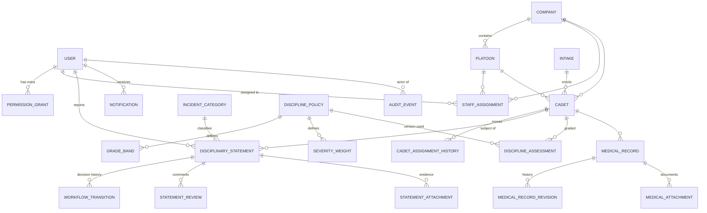

# Architecture

## Overview

OCMS is a server-rendered Django monolith split into apps with clear responsibilities. Business rules
live in service modules (`*/services.py`, `discipline/workflow.py`, `discipline/grading.py`); views only
validate input, check permissions and call services; templates contain no business logic.

```
Browser ──HTTPS──> Django (SecurityHeaders → Session → CSRF → Auth → AccountStatus → NoStore)
                     │
                     ├─ core          permission matrix, scoping, dashboards, settings, public pages
                     ├─ accounts      users, roles, grants, throttling, invitations
                     ├─ cadets        organisation, cadets, assignment history
                     ├─ discipline    statements, workflow state machine, grading engine
                     ├─ medical       restricted records & documents
                     ├─ reports       scoped statistics and exports
                     ├─ notifications in-app (+ optional e-mail)
                     └─ audit         append-only events
                     │
                     ├── PostgreSQL (all data; audit table protected by trigger)
                     └── Private file storage (PRIVATE_MEDIA_ROOT, never publicly served)
```

## Authorization model

1. **Authentication** — `login_required` on every non-public view; `AccountStatusMiddleware` ends the
   session of a user who is suspended or deactivated on their very next request.
2. **Permission** — `@require_perm(...)` checks permission codes from `core/permissions.py`
   (role defaults + active `PermissionGrant`s). Deny by default.
3. **Scope** — `core/scoping.py` filters every queryset by the user's active `StaffAssignment`s
   (company or platoon). Detail views fetch records *through* the scoped queryset, so guessing an id
   returns 403 (and is audited) rather than data (IDOR protection).
4. **Workflow actor** — `discipline/workflow.py` re-checks, on the locked database row, that the user is
   the authorised reviewer for that stage and is not the author.

## Entity relationship diagram



Key rules and constraints (enforced in the database where possible):

| Rule | Where |
|---|---|
| Cadet number unique | `UNIQUE` on `Cadet.cadet_number` |
| A cadet with a platoon must have a company; platoon belongs to that company | `CHECK` + model/form validation |
| Platoon codes unique within a company | `UNIQUE(company, code)` |
| Staff assignment targets exactly one unit; no duplicate active assignment | `CHECK` + partial `UNIQUE` |
| Only one active grading policy; one current assessment per cadet | partial `UNIQUE` |
| Grade band `max ≥ min`; band labels unique per policy | `CHECK`, `UNIQUE` |
| One active grant per user/permission | partial `UNIQUE` |
| Notifications idempotent | partial `UNIQUE(recipient, dedupe_key)` |
| Audit rows can never be updated or deleted | PostgreSQL trigger (migration `audit/0002`) |
| Records referenced by history cannot be deleted | `on_delete=PROTECT` throughout; archive instead |

Normalisation notes: `StatementReview` (free comments) and `WorkflowTransition` (status decisions) are
kept separate so that the decision history is an exact, immutable log of state changes. A statement
stores a *routing snapshot* (company/platoon at submission) so later cadet moves do not re-route or
hide historical statements.

## Disciplinary workflow

```
            submit                 platoon_approve              company_approve
  DRAFT ───────────▶ SUBMITTED ───────────────────▶ COMPANY_REVIEW ───────────────▶ APPROVED
    ▲                (pending platoon)    │  │             │  │
    │ resubmit                 platoon_   │  │ platoon_    │  │ company_reject
  RETURNED ◀──────────────────── return ──┘  └ reject ─┐   │  └──────────────────▶ REJECTED
    ▲                                                   └───┼──────────────────────▶ REJECTED
    └────────────────────────── company_return ────────────┘
  DRAFT / SUBMITTED / RETURNED ── withdraw (author, reason) ──▶ WITHDRAWN
```

* Transitions are declared once in `TRANSITIONS`; the only code path that changes a status is
  `workflow.perform()`, which locks the row (`SELECT … FOR UPDATE`), checks the optimistic `version`,
  checks source status, actor and reason, writes the transition, audit event and notifications, and
  recalculates the grade — all in one transaction (rolled back together on any failure).
* Setting `require_company_review = off` makes platoon approval final.

## Grading engine

`score = base_score − Σ severity_points(approved statements in the policy period)`, floored at 0, then
mapped to the policy's grade bands. Each `DisciplineAssessment` stores the policy version, the score,
the band (label, colour, icon) and an itemised explanation. Policies are versioned: an activated
version becomes read-only; changes create a new version and activation recalculates every cadet while
old assessments remain in history. Overrides require a reason and are audited. Bands can be marked
“requires human review” — this only notifies company commanders; nothing is ever automatic.
